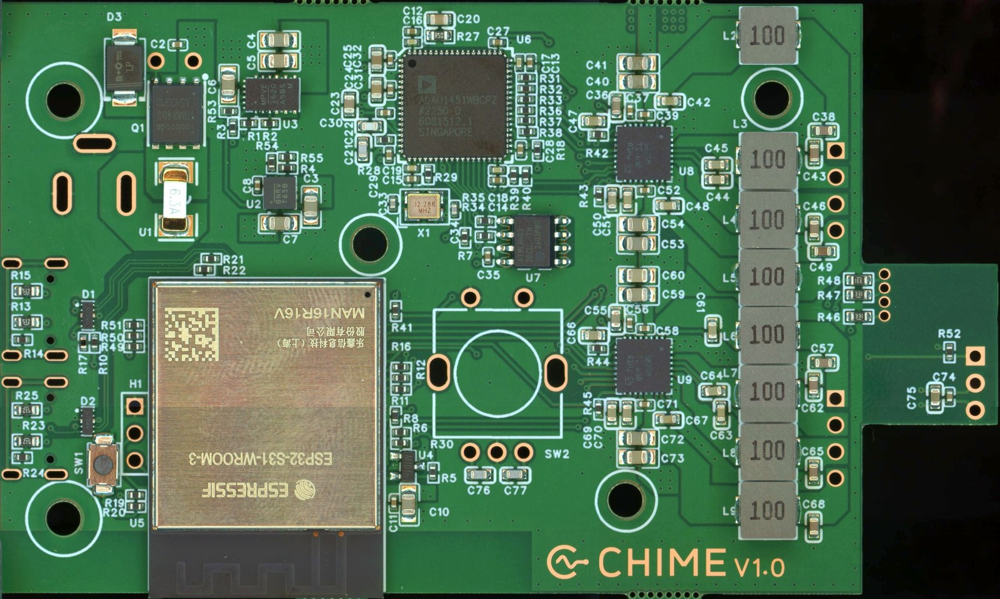

[简体中文](README.zh-CN.md)

# Chime

[Read the build story →](https://branzhu.github.io/chime-dsp-audio/)

Chime is my DIY 2.1 desktop speaker project. It started with a Creative Stage SE soundbar that I didn't particularly enjoy listening to at low volume. Rather than throw it away, I kept its enclosure and drivers for bass, built a pair of small 3D-printed satellite speakers, and replaced the electronics with my own board.

The board uses an ESP32-S31 for USB/Bluetooth audio and system control, an ADAU1451 for DSP, and two TAS5825M Class-D amplifiers. I wanted a system I could measure, tune, and change without fighting the original firmware.

This repository contains the firmware, SigmaStudio project, PCB design export, and enclosure models. It's an ongoing personal project, not a ready-to-build speaker kit.



## Hardware and audio path

```text
USB Audio ───────┐
                 ├── ESP32-S31 ── I2S / TDM ── ADAU1451 DSP ── TAS5825M × 2 ── L / R / Sub
Bluetooth A2DP ─┘       │
                        └── Encoder / LED / Wi-Fi web UI
```

The two satellite speakers use 2-inch GP52-463 drivers in sealed, 3D-printed enclosures. The modified Stage SE handles the low-frequency channel. Its two drivers use separate BTL amplifier outputs; **do not connect those outputs in parallel**. See [hardware safety and known issues](docs/safety.md) before powering a build.

## What's working

- **USB Audio:** 48 kHz, stereo, 16-bit PCM.
- **Bluetooth A2DP:** SBC and AAC-LC, with experimental paths for aptX, aptX HD, Android Opus, LDAC, and LHDC V5. Codec paths in the source are not necessarily validated across phones or long listening sessions. LDAC/LHDC currently provide 44.1/48 kHz stereo PCM16; LHDC V2/V3 aren't supported.
- **Simultaneous audio:** USB and Bluetooth are mixed on the ESP at 48 kHz using Q5.27 PCM, Q2.30 gains and 64-bit intermediates. Bluetooth uses an adaptive polyphase FIR SRC. There is no fixed mixing attenuation or automatic gain: keep source volumes low; overload saturates and is counted. Board-level coexistence and timing validation is still pending.
- **DSP control:** SigmaStudio project and firmware parameters are checked against each other, including the compiled DSP image.
- **Controls:** encoder sends PC volume keys over USB HID; set Chime as the PC default output. Press mutes/unmutes both inputs locally; long press toggles standby. Phone volume controls Bluetooth independently; RGB LED for status. Wi-Fi setup and manual controls are available through a web UI.
- **Debugging:** SigmaStudio TCP bridge for use on a trusted LAN, plus host-side tests for audio, controls, codecs, and DSP data.

The DSP currently does the ordinary work—crossover, PEQ, and gain. Dynamic loudness, virtual bass, and the other ambitious ideas that justified buying a dedicated DSP are still on my to-do list.

## Building the firmware

The current toolchain is **ESP-IDF 6.1**, target `esp32s31`. In an activated ESP-IDF environment, from the repository root:

```sh
idf.py --preview -C software build
```

The first build downloads pinned Espressif components. See [build instructions and host tests](docs/build.md) for details.

I haven't packaged a one-click flashing procedure. In particular, don't mix a new application with an old partition table or casually erase NVS to fix Wi-Fi setup; see [known issues and flashing precautions](docs/safety.md).

## Files

| Directory | What's in it |
| --- | --- |
| [`software/`](software/) | ESP-IDF firmware, components, host tests |
| [`dsp/`](dsp/) | SigmaStudio project, generated data, ESP32 parameter bindings |
| [`hardware/`](hardware/) | EasyEDA PCB project export, schematic and PCB PDFs, and BOM; **not** a Gerber package |
| [`mechanical/`](mechanical/) | STEP / 3MF models for the satellite enclosure, rear panel, and feet |
| [`scripts/`](scripts/) | Build, DSP sync, testing, and release helpers |
| [`tools/wireshark/`](tools/wireshark/) | SigmaDSP protocol analysis tools |
| [`docs/`](docs/README.md) | User guides in English and Simplified Chinese |

See the [PCB notes](hardware/README.md) for board files and pre-manufacturing checks. Enclosure files are in [`mechanical/`](mechanical/); check units, dimensions, tolerances, and print settings before use.

## Notes and documentation

- [Architecture and code map](docs/architecture.md)
- [Build and tests](docs/build.md)
- [Safety and known limitations](docs/safety.md)
- [Licensing and third-party code](docs/licenses.md)

## Credits and licenses

All seven external Bluetooth codec backends now use [ESP32-S31-A2DP-Codecs](https://github.com/WillyBilly06/ESP32-S31-A2DP-Codecs). Thanks to WillyBilly06 and the upstream codec authors. The pinned revision and every imported file are recorded in the [codec import manifest](software/components/chime_codec_reference/UPSTREAM.json); see the [migration and known LHDC level regression](software/components/chime_codec_reference/README.md). Only codec libraries are imported, not the upstream Bluetooth host or renderer. The retired [freeaptx import](software/components/chime_freeaptx/UPSTREAM.json) from [ESP32-A2DP-SINK-WITH-CODECS-UPDATED](https://github.com/WillyBilly06/ESP32-A2DP-SINK-WITH-CODECS-UPDATED) is retained for history but is not linked.

Different parts of this repository have different licenses:

- My firmware and original DSP configuration contributions: [Apache-2.0](LICENSE).
- My PCB design: [CERN-OHL-P-2.0](LICENSES/CERN-OHL-P-2.0.txt).
- My documentation and the original designs in the listed STEP / 3MF files: [CC BY 4.0](LICENSES/CC-BY-4.0.txt).

**Some imported LDAC and adapter code still has unresolved redistribution permissions.** The licenses above do not cover that code, other third-party material, or project branding. Please read [third-party notices](THIRD_PARTY_NOTICES.md) and [license scope](LICENSES/README.md) before reusing or redistributing it.

## Issues and contributions

Bug reports and suggestions are welcome. If something breaks, please include the board revision, firmware commit, ESP-IDF version, audio source/phone, negotiated codec if applicable, and enough logs to reproduce it. Remove credentials and other private information first.
