# I Turned a Creative Stage SE into a 2.1 Speaker System

## 1. My Speaker Died. Again.

I have a Bose SoundLink Mini II, and I've always liked it. I'm still impressed by the sound Bose managed to get out of such a small, nicely built enclosure, especially the bass.

But the battery died. Again. That's twice now.

The thing is, I use it as a PC speaker. It's plugged into power all the time, so I don't even need the battery. Yet when the battery dies, the entire speaker refuses to work, even with the power connected. And replacing the battery isn't exactly easy. I can't help suspecting a bit of planned obsolescence on Bose's part. Anyway, I needed a desktop speaker again.

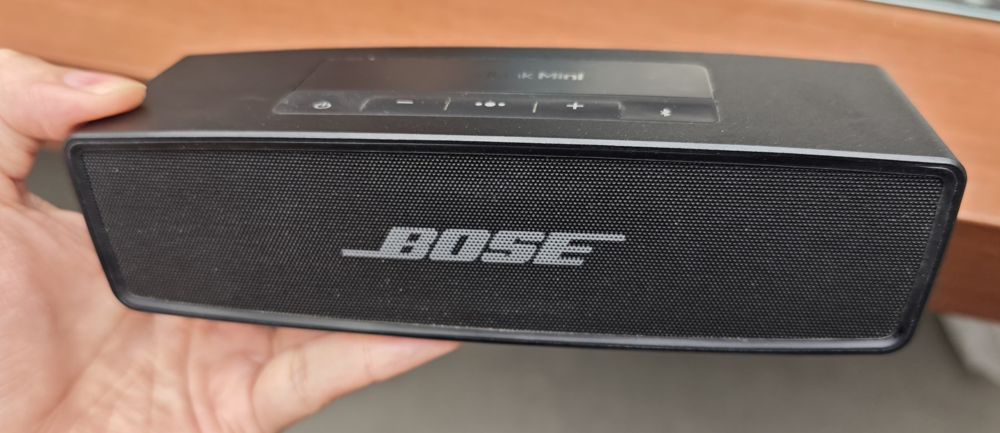

## 2. The Creative Stage SE Gathering Dust

I dug out a Creative Stage SE that had been collecting dust on a shelf. I'd bought it as a replacement when the SoundLink Mini II died the first time, listened to it for about fifteen minutes, and put it away.

I sit quite close to my speakers, on either side of my monitor, and usually listen at low volume. At those levels, the Stage SE sounded awful to me. The mids were muddy as hell. I'm no audio expert, and I couldn't tell you whether the problem was frequency response, distortion, or something else. I just knew something wasn't right.

Now the Bose was dead for the second time, and the Stage SE could at least make noise. I didn't particularly want to buy yet another speaker.

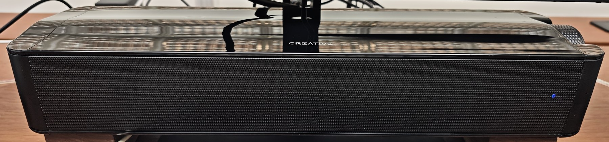

## 3. An Idea

Could I improve the Stage SE enough to get somewhere near the sound of the SoundLink Mini II? I'm certainly no audio specialist, and I'm not going to out-engineer Bose's acoustics team. But if I allow myself several times the size and power budget, surely I have a fighting chance.

I don't want a pair of large bookshelf speakers on my desk. Small speakers are easy to fit, but bass is usually where they struggle. So what if I let the Stage SE handle only the low frequencies and built a pair of tiny satellites for the mids and highs? That would give me a 2.1 system.

The Stage SE already has a long enclosure, two oval active drivers, a passive radiator, and a rather elaborate-looking bass-reflex port. I had no idea how much bass I could really get out of it, but it seemed worth trying. Most importantly, I already owned it.

I figured this project needed a name, so I called it **Chime**.

## 4. A Quick Measurement

Before taking it apart, I thought I'd check whether my ears were onto something. I made a massive investment of **$60** in an Eversolo EM-01 measurement microphone and ran a frequency sweep in REW.

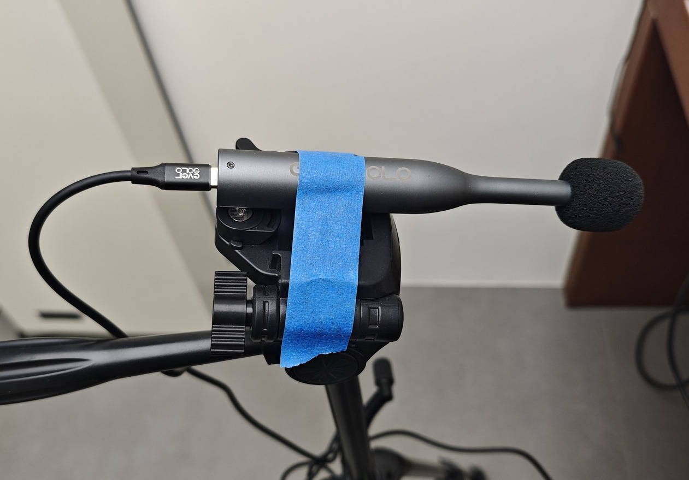

ChatGPT and I (mostly ChatGPT) carefully examined the response and reached a highly technical conclusion: something about that frequency response looked a bit off.

I used REW's measurements and EQ optimization to set up some corrections in Equalizer APO. I don't know what kind of magic happened in there, but the muddy mids cleared up quite a bit. It really did sound better.

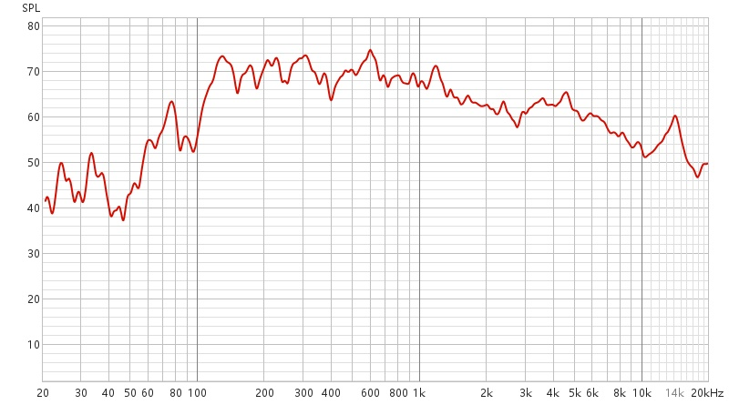

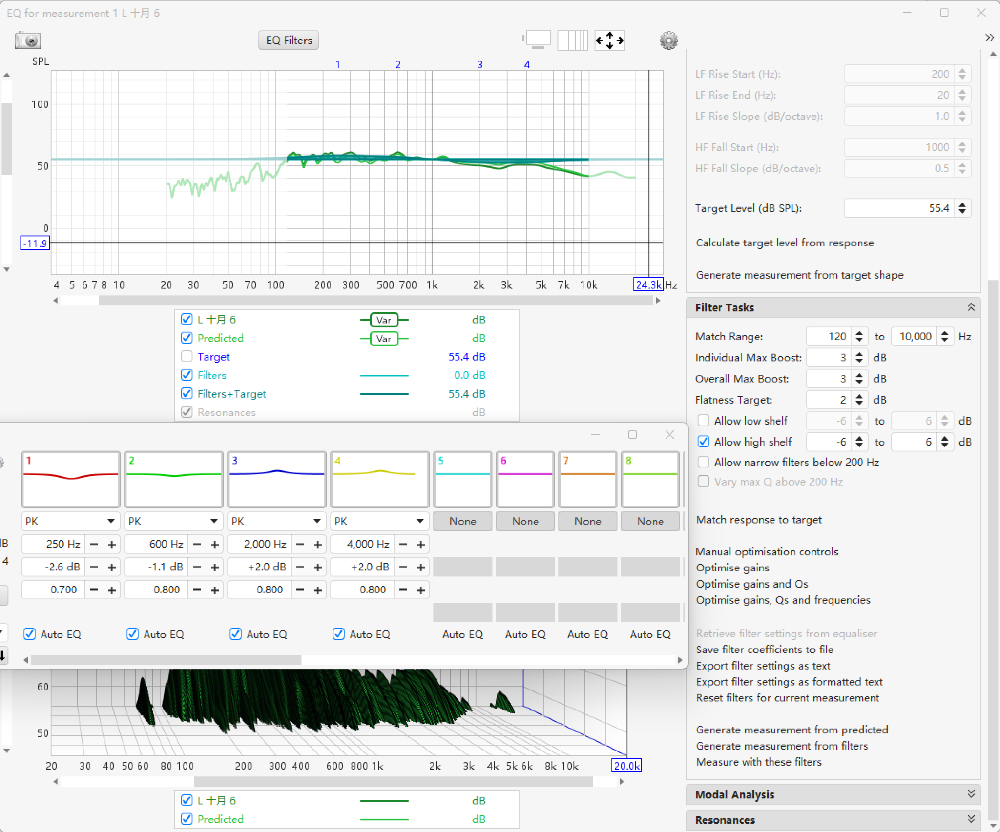

Maybe I should have stopped there and gone back to enjoying music. Yeah, right. I'd already started a project. I wasn't going to stop that quickly.

## 5. Opening Up the Stage SE

Getting into the Stage SE starts with the metal grille. It's held onto the plastic enclosure with clips, but Creative also added glue, so it wasn't as straightforward as I'd hoped. I sacrificed a pair of pointed tweezers, pushed one tip through a grille hole near the bottom-right corner, and pried it out. It worked, though the plastic housing acquired a few battle scars.

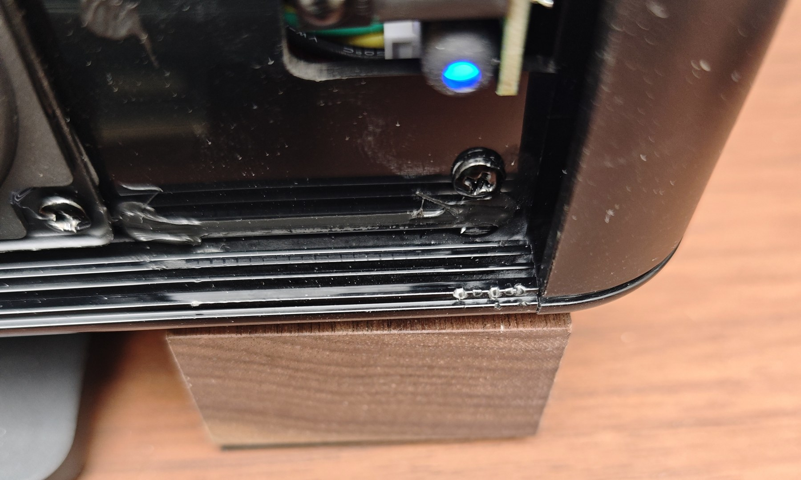

After the grille came off, things got easier. Three screws let me remove the electronics assembly. It took a little more effort to free the PCB, and I was surprised by how simple it was.

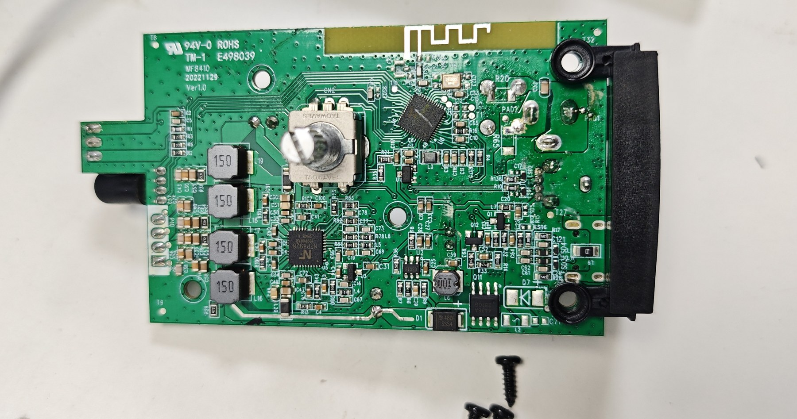

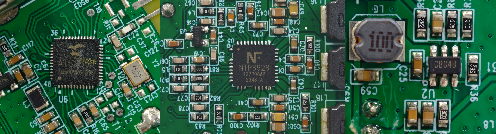

There are basically three main chips. The **Actions ATS2853** handles Bluetooth, USB, audio DSP, and system control. The **NeoFidelity NTP8928** is a 2 × 20 W digital amplifier with some DSP features of its own. The last one is a fairly unremarkable DC-DC regulator, possibly a JSMSEMI MP2359. And all of this fits on a single two-layer PCB.

Remarkably simple, and clearly very cost-effective. Well done, Creative!

My plan was to design a replacement PCB and turn the Stage SE into a 2.1 system. The original Stage SE came with a 15 V, 2 A power adapter, giving me 30 W to work with. I figured I'd just reuse it since I usually listen at low volumes.

Wait a minute. Didn't Creative advertise this thing as a 48 W speaker? I checked the fine print on the back of the box. Sure enough, 48 W peak power, 24 W RMS.

*Well done, Creative, well done!*

## 6. Fancy BOM

If I was going to design a new PCB, I might as well try a few things I'd been curious about.

For the main controller, Espressif had just started shipping the **ESP32-S31**. It's a dual-core RISC-V chip with USB High-Speed, Wi-Fi 6, and, importantly for this project, Bluetooth Classic. With ESP-IDF and the ESP32 community behind it, it was a pretty easy choice.

I also wanted to experiment with things like Dynamic Loudness, Virtual Bass, and Virtual Surround, so I picked an **ADI ADAU1451**. It has plenty of DSP horsepower, and SigmaStudio+ lets me build signal-processing paths graphically. I was looking forward to seeing what I could do with it.

For amplification I chose the **TI TAS5825M**, a closed-loop Class-D amplifier with digital audio input. Its noise and distortion specs looked very good. Noise mattered to me in particular: the speakers would be sitting close by, usually playing at low volume, and I didn't want to hear hiss. Two TAS5825Ms give me four amplifier channels, enough for the two satellites and the two drivers inside the Stage SE.

For the 3.3 V and 1.2 V supplies, I used two MPS buck power modules with integrated inductors. MPS puts the power inductor inside the package, making the modules tiny and the external circuitry pleasantly simple. I'd been interested in these modules for a while, and finally had an excuse to use them.

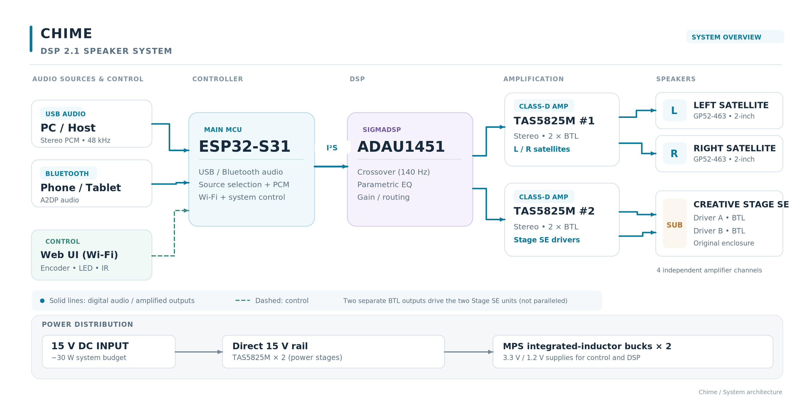

Creative had built the original electronics around three main ICs. Mine was considerably more complicated, but I wasn't designing for mass production. Being able to experiment and change things mattered more to me than minimizing the BOM cost.

I ordered five PCBs. Components cost about $155, PCB fabrication $8, and SMT assembly $89. That's $252 in total, or roughly $50 per board.

Ouch.

I used EasyEDA and JLCPCB for the whole PCB workflow. They aren't sponsoring me (unfortunately). It's just that the component library, schematic and PCB tools, ordering, and SMT assembly work so conveniently together that it's hard to say no for a personal project.

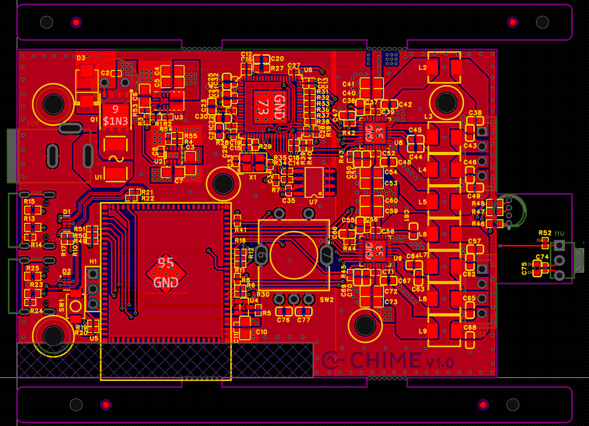

## 7. Satellite Speakers

The satellite requirements were fairly straightforward: around 2 inches, 4 Ω, and decent mids and highs. I wasn't asking them to produce much bass. After looking around, I chose the **GP52-463**, at about $3.50 each. It has a distinctive ring of yellow fiberglass cloth, which I rather like the look of.

I designed small sealed enclosures in CAD for 3D printing, with rounded front baffles. ChatGPT told me rounded baffle edges could reduce diffraction, which sounded reasonable enough. I also happened to have a new spool of ASA filament that looked promising, so that's what I used.

The actual prints looked considerably worse than the CAD model. The thick ASA enclosures had obvious elephant's foot and some warping, and the smooth transition around the front baffle came out rough and pitted no matter what I did with the supports. Oh well. I can live with it if I look at it long enough.

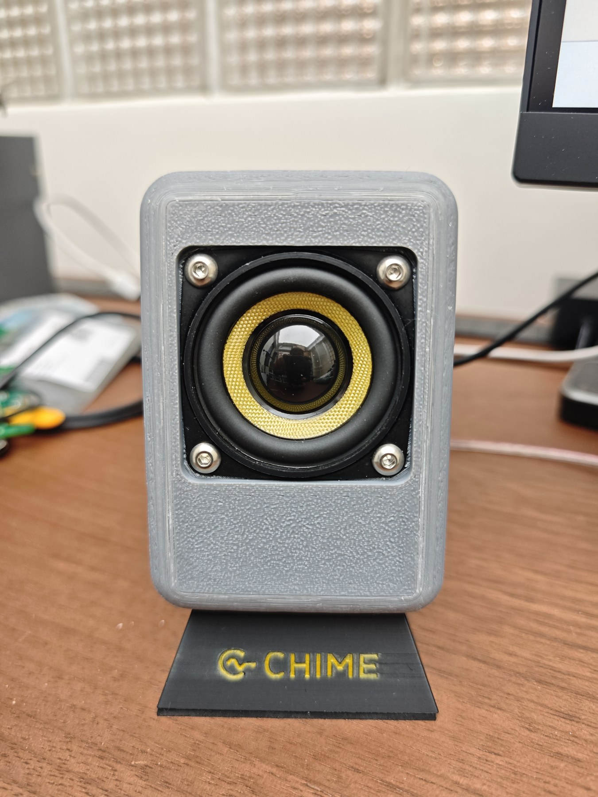

Since these are sealed boxes, I needed gaskets between the front and rear halves and around the drivers. I got some adhesive-backed EVA foam. The sensible approach would have been to print the gasket outline at 1:1 scale, stick it onto the foam, and cut it with a knife. But I had access to a laser marking machine, so I tried that instead.

The shapes came out perfectly. I also nearly set off the smoke alarm. The foam seemed to hold onto the smell, but once I sealed the enclosures I couldn't smell it anymore. Lesson learned.

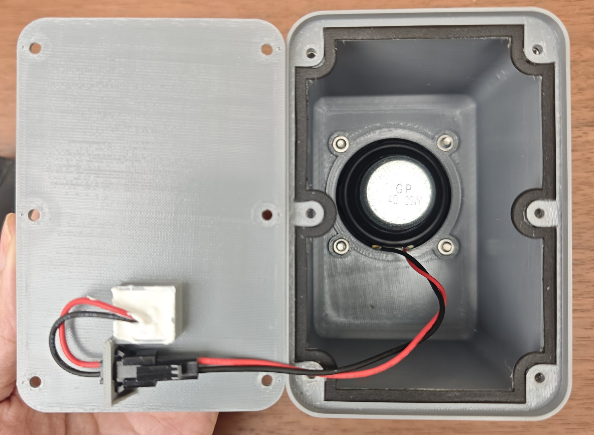

The connector took a bit of searching, too. I wanted something small, not too ugly, easy to make cables for, and mountable in the enclosure. I settled on a two-pin JST SM wire-to-wire connector and designed a mounting feature for it. It's nothing exotic, but it does the job nicely.

For cable I bought transparent speaker wire with a red marking along one conductor to identify polarity. In the product photos it was a nice, saturated red. In real life, for reasons I still don't understand, it was pink.

Finally, I designed a pair of 15° angled stands to point the satellites toward my ears on the desk. More 3D printing, of course. Ahem. For a small accessory like this, I think PLA is perfectly fine.

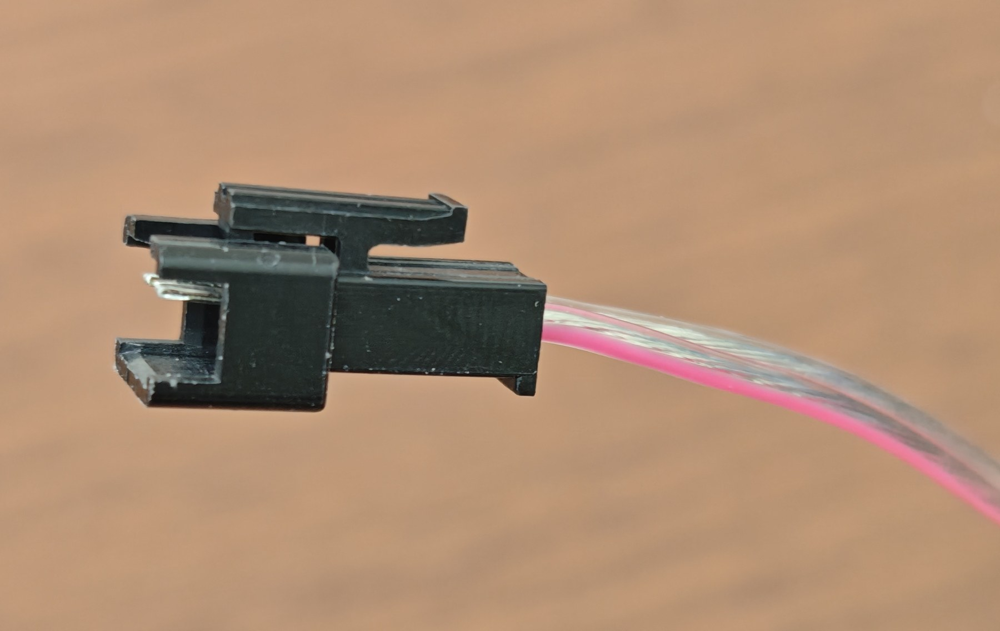

## 8. Bring-up

After some waiting, the PCBs arrived. To save money, I'd left the USB connectors, an electrolytic capacitor, and the LED, IR receiver, and encoder salvaged from the Stage SE board for hand soldering.

That electrolytic capacitor nearly killed me. I'd connected its pads directly to three large copper pours without thermal reliefs. The soldering iron simply couldn't get enough heat into the joint. I eventually managed it with the iron, hot air, flux, and solder paste all involved. At one point I was seriously tempted to staple the thing onto the PCB.

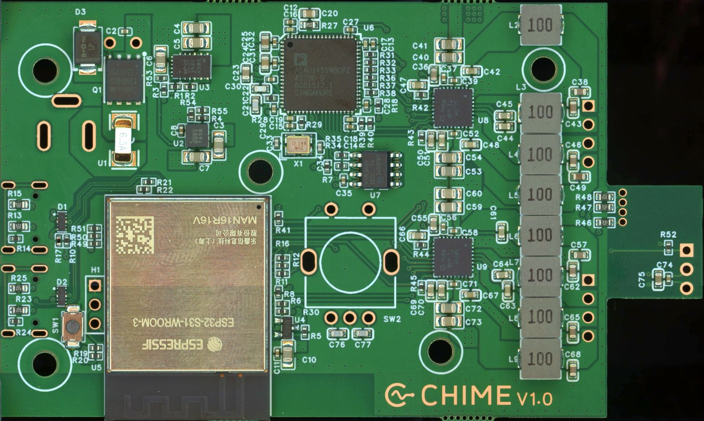

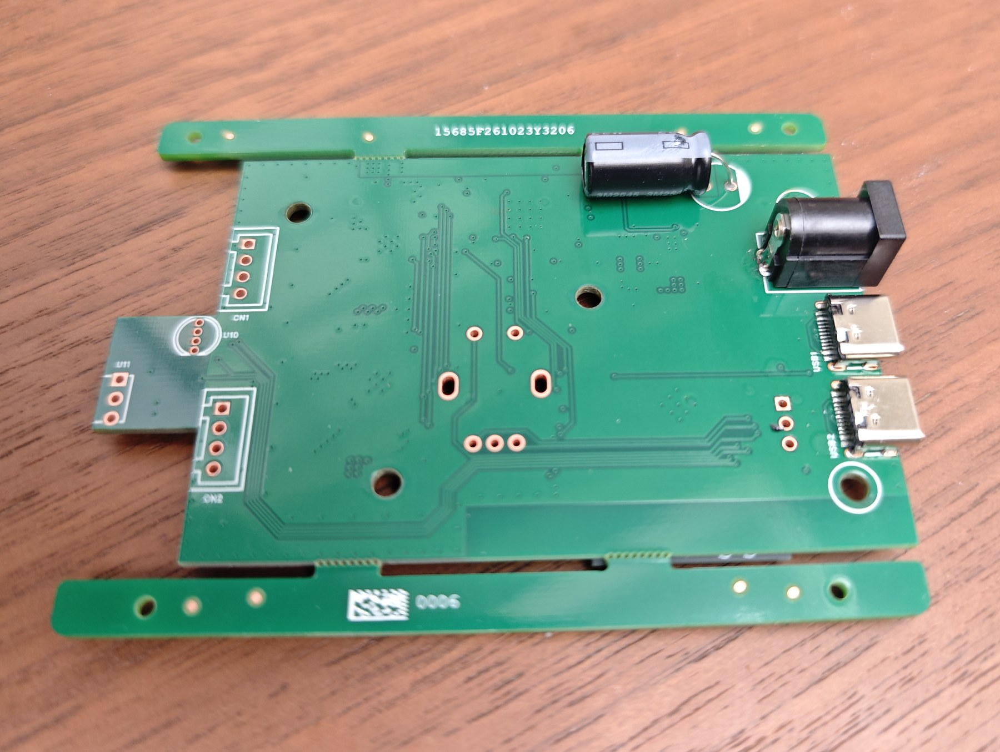

The new PCB also meant I had to redesign the Stage SE's rear panel. The original was tiny, so I designed and 3D-printed a replacement with all the connectors I needed. As you can see, things got a little crowded back there.

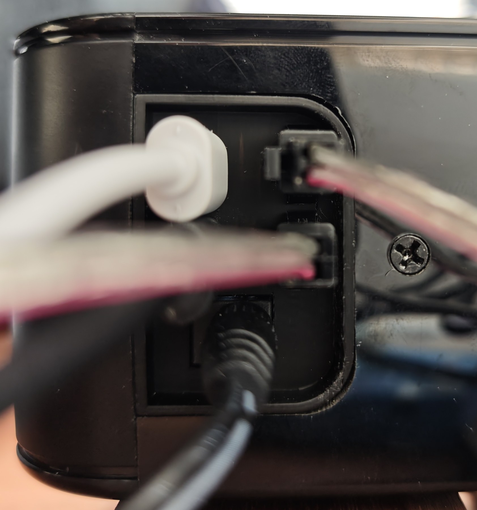

There isn't much to brag about on the software side. I worked through the project's PRD in detail with Codex, then had it write most of the code. We started with diagnostic firmware to check chip startup and communication, then a test firmware generating a fixed sine wave to verify the audio path, and finally USB Audio so the PC could recognize the board as an audio device.

This part is a little sad for me, actually. I've been developing embedded software for over ten years, but my relationship with AI agents has changed remarkably fast over the past year or so. At first, I happily asked them for little pieces of code just to see what they'd produce. Then they started helping with real work. Then they became an important partner—or possibly a competitor. Now I've almost stopped writing code myself. I'm not as fast as Codex, and I don't think I write it as well either.

I still need to decide what to build, judge whether a design makes sense, and figure out what test results mean. But writing code with my own hands used to be a part of the job I really enjoyed, and that part is disappearing. *I feel a part of me is lost.*

At least Codex still can't solder that damn electrolytic capacitor for me. Yet.

## 9. Let There Be Music

I'm old enough now to have watched a song go from a hit, to a classic, to an oldie.

After some bring-up work, the speakers finally made sound. I could tell you I held my breath and pressed Play for the first time, but if you've done hardware or firmware development, you know that's rarely how it happens. Usually you're in the middle of some unremarkable test, change something, reflash, and suddenly audio comes out.

Anyway, voilà: Sia's *Elastic Heart* was finally playing through speakers I'd built myself. At that point, only the two satellites were connected—no sub, no tuning. But the crisp drum hits and the mids and highs already sounded quite good to me. Expecting serious bass from a pair of two-inch speakers would have been unreasonable.

Next I fitted the PCB into the Stage SE. I had to cut off a plastic post that was in the way, then discovered I'd soldered the LED and IR receiver backward and had to redo them. After those minor detours, the Stage SE and the satellites finally formed a complete 2.1 system.

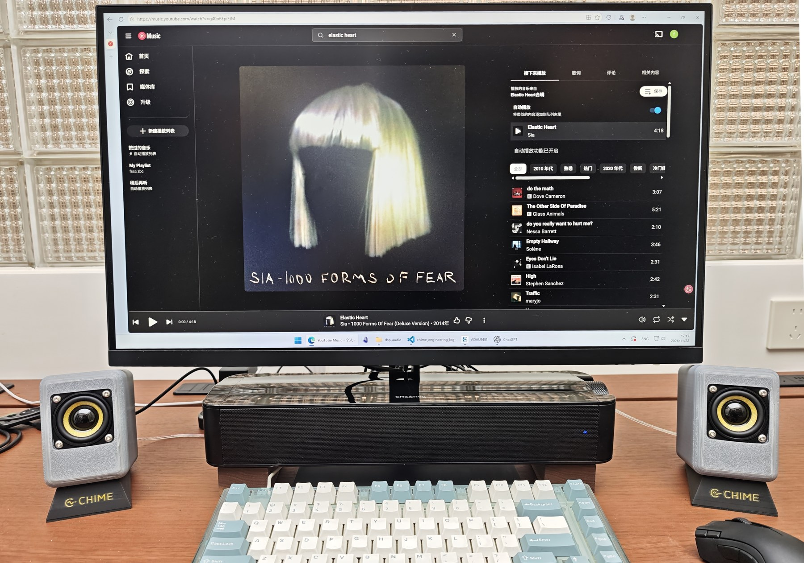

## 10. Curse Tuning

I added a crossover in SigmaStudio+, set it to 140 Hz, and played *Elastic Heart* again. The snare still sounded crisp, but where was the sub-bass? There was practically none.

Another REW sweep made it clear enough, the Stage SE had decent output above 60 Hz, then dropped off steeply. At 30 Hz, there was barely anything left. Its passive radiator seemed to be tuned somewhere around 60 Hz. Fair enough, the Stage SE was originally designed as a full-range soundbar, not a dedicated subwoofer.

But now I was using it only for bass, and I normally listen at low volumes, so I figured I could try some more aggressive EQ. Codex was much less helpful here than it had been at writing firmware. It kept suggesting another 0.1 dB here, another 0.1 dB there. Dude, the entire system runs on a 30 W power supply. I'm not throwing a concert, and I don't have neighbors to worry about. How long is this going to take? Let's try +10 dB at 30 Hz!

After some PEQ tweaking, another REW sweep looked noticeably better, and it sounded better too. When I played Omide & Rick Jansen's *Toxic*, I finally thought now we're getting somewhere with the bass.

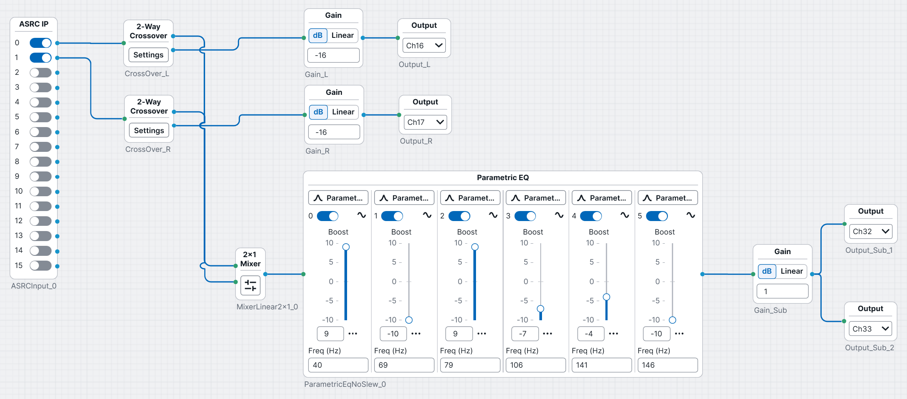

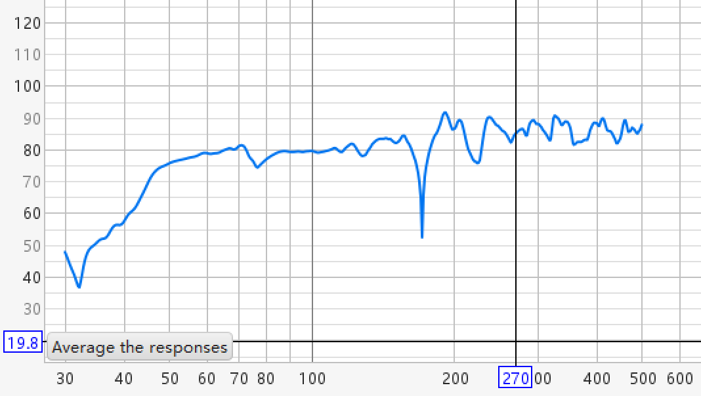

A note on that dip around 170 Hz, it's room-related. Moving the microphone changes the depth of the dip. The sub response still isn't quite where I want it, and I haven't EQ'd the satellites at all, so there's more tuning to do.

## 11. Bluetooth

Bluetooth should probably have been a whole adventure, but I barely got to take part. ESP-IDF already provides a lot of the groundwork, and Codex wrote most of the rest. I described what I wanted, built it, tested it, and it worked. After more than a decade in embedded development, I almost missed fighting with Bluetooth stacks. Almost.

I also came across [ESP32-A2DP-SINK-WITH-CODECS-UPDATED](https://github.com/WillyBilly06/ESP32-A2DP-SINK-WITH-CODECS-UPDATED), which plays with advanced codecs including AAC, aptX, LDAC, and LHDC. The licensing for some of these codecs is complicated enough to keep a room full of lawyers busy. But surely I can try them out for myself... right?

## 12. Wait, Where Are the Advanced Audio Algorithms?

Hold on. What happened to all those advanced audio algorithms? I talked about Dynamic Loudness, Virtual Bass, and Virtual Surround, and even chose a powerful ADAU1451 specifically to experiment with them. So far, I've used it for a crossover, PEQ, and gain. Things I could have done on the ESP32 itself.

I'm not being lazy. It's just that after all this tinkering, I'd like to listen to some music and take a break.

Just for a little while.

---

This project was developed by me, ChatGPT, and Codex. I handled the hardware, testing, soldering (unfortunately), and, most importantly, paid the bills. ChatGPT helped with the design and analysis, and regularly assured me that I was absolutely right. Codex wrote most of the firmware.

The published firmware and design files are on GitHub: [chime-dsp-audio](https://github.com/branzhu/chime-dsp-audio). See the [license and third-party notes](https://github.com/branzhu/chime-dsp-audio/blob/main/docs/licenses.md) for what you can reuse and redistribute.

